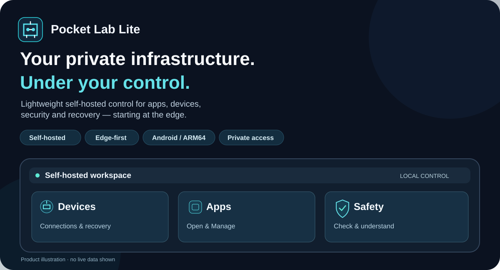
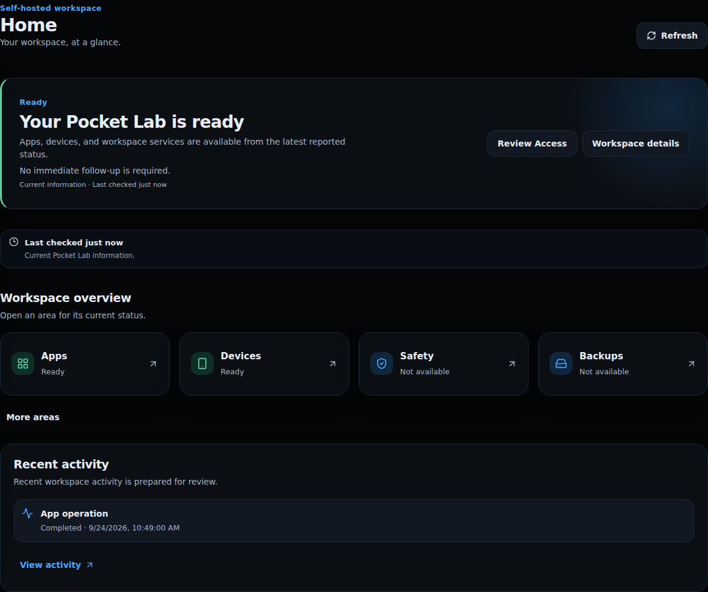
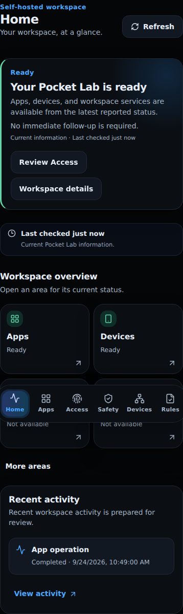
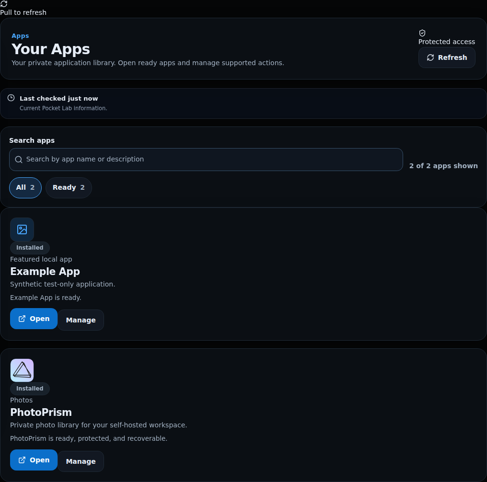
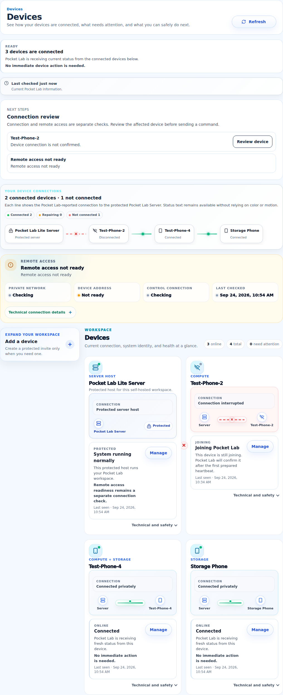
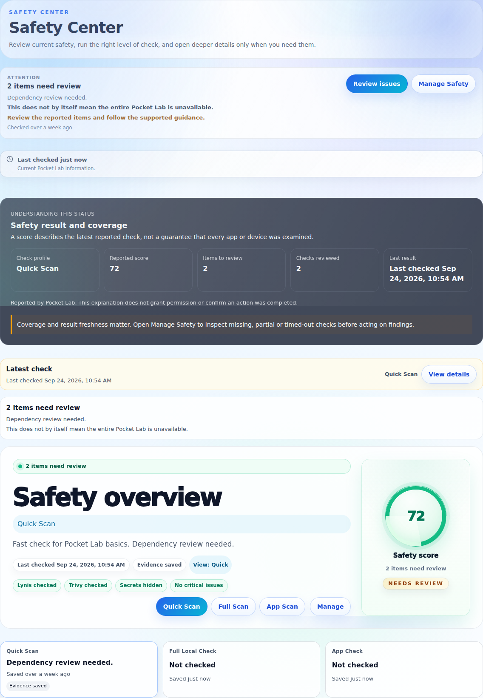
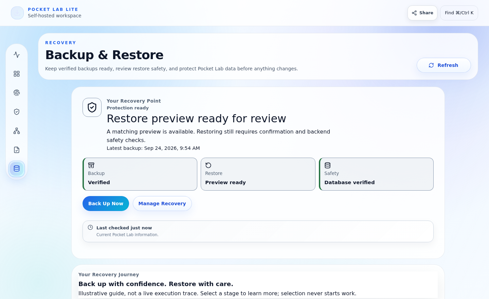
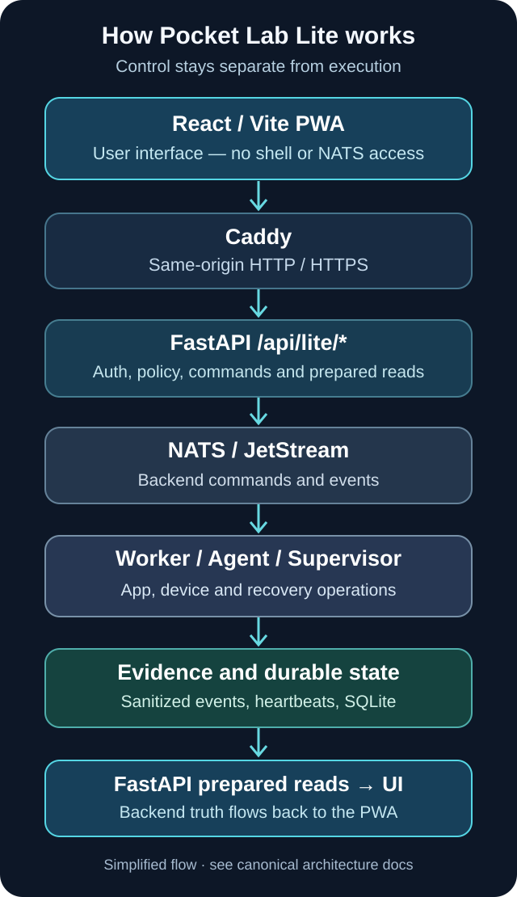

# Pocket Lab Lite

**Your private infrastructure. Under your control.**

A lightweight, self-hosted control plane for running apps, managing devices, checking security, and recovering services — starting with Android and low-power hardware.

**Self-hosted** · **Edge-first** · **Android / ARM64** · **Private access**

<a href="https://dexter-lab-ctrl.github.io/pocket-lab-lite/"><strong>Documentation</strong></a> ·
<a href="https://github.com/dexter-lab-ctrl/pocket-lab-lite/releases/latest"><strong>Get the latest release</strong></a> ·
<a href="docs/getting-started/android-termux.md"><strong>Get started</strong></a>

<picture>
  <source media="(max-width: 640px)" srcset="docs/assets/brand/readme-hero-mobile.svg">
  
</picture>

Illustrative workspace overview — original repository artwork, not a live system capture.

## A look inside Pocket Lab Lite

A PWA for a real, self-hosted control plane. These are **existing Playwright visual-regression captures of the Pocket Lab Lite UI using deterministic mocked backend states**. They show interface design, **not** a live installation or production evidence.

<table>
  <tr>
    <td width="60%"></td>
    <td width="40%"></td>
  </tr>
  <tr><td><strong>Desktop workspace</strong> — current state and safe next steps.</td><td><strong>Mobile PWA</strong> — the same workspace designed for a small screen.</td></tr>
</table>

> [!NOTE]
> Screenshots above and below come from committed mocked UI baselines. Actual device state, successful operations, installed apps, and security posture depend on your own deployment. [Visual provenance and deferred live-capture plan](docs/README-media-source.md).

## Why Pocket Lab Lite?

| Keep control close | Use hardware you already have | Know what happens next |
| --- | --- | --- |
| Run the control plane on your own host, with private access where configured. | Start with Android/Termux and ARM64-friendly operation rather than requiring a large server stack. | See device health, app readiness, safety results and recovery steps in one place. |

## Explore the features

### Home — Know how your workspace is doing

See workspace readiness, service information, activity and relevant next actions without starting a backend operation simply by opening a card. [Explore Home](docs/generated/production/home.md).

### Devices — Bring your devices together

Enroll supported devices with backend-generated invites and identity guards, review connection and remote-access readiness, and follow agent-recovery guidance when a device is offline. [Explore Devices](docs/generated/production/devices.md).

### Apps — Self-hosted applications, managed simply

Open installed apps, use **Manage** to review health and available actions, and see how app safety and recovery fit together. **PhotoPrism** is the documented production adapter; registry support does not mean arbitrary third-party apps can be installed. [Explore Apps](docs/generated/production/apps.md) · [Platform boundaries](docs/architecture/universal-app-platform.md).

### Safety — Understand your local safety posture

Run a bounded **Quick Safety Check**, choose deeper **Full Local Check** or supported **App Check** profiles when available, and review findings, changes and coverage limits. Checks provide evidence, **not a guarantee of security**. [Explore Security](docs/generated/production/security.md).

### Recovery — Prepare for the unexpected

Review backup readiness, verify a backup, preview a restore before changes, and use confirmation and checkpoint safeguards for supported recovery operations. A backup is not automatically verified and not every restore path is ready. [Explore Recovery](docs/generated/production/recovery.md).

### Identity & Access — Decide who can do what

Manage local sign-in, passkeys, owner access and sessions. Personal Mode is the default; role-aware Enterprise Mode is opt-in. External identity federation is not part of the documented local credential workflow. [Explore Identity](docs/generated/production/identity.md).

### Rules — Keep protected actions governed

Review bounded safety rules and decisions for registered operations. Coverage is **limited to explicitly registered actions**; this is not a promise of general-purpose automation or enforcement for every action. [Explore Rules](docs/generated/production/rules.md).

### Product views

<table>
  <tr><td width="50%"></td><td width="50%"></td></tr>
  <tr><td><strong>Apps</strong> — see what is available to open and manage.</td><td><strong>Devices</strong> — distinguish connected, offline and recovering states.</td></tr>
  <tr><td></td><td></td></tr>
  <tr><td><strong>Safety</strong> — findings and checks, with limits made visible.</td><td><strong>Recovery</strong> — review readiness before a guarded restore.</td></tr>
</table>

Mocked, deterministic UI reference images; not proof of a successful live operation.

## How it works

The browser is the **control surface**, not the execution engine. The PWA talks to FastAPI through Caddy; NATS/JetStream carries backend commands, workers and agents execute them, and sanitized evidence and prepared state come back through FastAPI. [Detailed architecture](docs/architecture/lite-architecture.md) · [Trust boundaries](docs/security/lite-security-model.md).

## Get started

1. **Check the host and prerequisites.** Android with Termux is the documented Lite host path. Start with the [Android/Termux guide](docs/getting-started/android-termux.md) and [supported-platform evidence](docs/generated/production/intelligence/supported-platforms.md).
2. **Obtain the software.** Use the [latest GitHub release](https://github.com/dexter-lab-ctrl/pocket-lab-lite/releases/latest) and its published artifacts (including `dist.zip` and `checksums.txt` where provided), or clone this repository for the source/bootstrap workflow. Verify release integrity before installation.
3. **Follow the documented bootstrap.** In Termux, the source checkout provides the repository-owned `scripts/bootstrap.sh --profile lite` pathway under `pocket-lab-final-structure/pocket-lab-bootstrap-production-scripts-patched`. Read the [canonical installation guidance](docs/generated/production/installation.md); setup has prerequisites and environment-specific steps.
4. **Open the dashboard** at the local URL reported by bootstrap. Private remote access through Tailscale requires its own readiness and HTTPS configuration. [Remote access guidance](docs/generated/production/remote-access.md).
5. **Add a device only through the app's Add Device flow**; the backend issues the enrollment command and applies identity guards. [Device onboarding](docs/operations/devices-durable-enrollment.md).

This is a self-hosted installation, not a hosted sign-up or a universal one-command installer.

## Platforms and compatibility

| Surface | Role | Scope |
| --- | --- | --- |
| Android / Termux (ARM64) | Primary Lite server-host target | Bootstrap, runtime and device-host behavior; actual readiness depends on host setup |
| ARM64 Ubuntu / PROot | Supported app/runtime context | Capability-specific, not identical to native Android/Termux |
| Ubuntu / WSL2 | Development and validation | Developer workstation, **not** an Android deployment substitute |
| Mobile or desktop browser | PWA user interface | Requires reachability to a running Pocket Lab Lite host |
| Secondary device | Managed device | Enrollment, supported runtime and remote-access prerequisites apply |

[See the evidence-based platform matrix](docs/generated/production/intelligence/supported-platforms.md) and [current limitations](docs/generated/production/limitations.md) before assuming capability parity.

## Designed for private control

Pocket Lab Lite keeps system operations behind a server-owned control API. The browser does not execute shell commands, connect directly to NATS, or hold backend execution secrets. Device onboarding has identity checks; supported Tailscale access provides a private networking option; safety checks, restore guards and sanitized troubleshooting records support accountable operation.

Self-hosting still requires updates, access control, backups and careful administration. Neither a safety score nor a private network eliminates risk. [Security model](docs/security/lite-security-model.md).

## Documentation

**Discover here. Learn, operate, develop and validate in the [Documentation Platform](https://dexter-lab-ctrl.github.io/pocket-lab-lite/).**

| For | Start here |
| --- | --- |
| New operators | [Installation](docs/generated/production/installation.md) · [Getting started](docs/getting-started/android-termux.md) |
| Device and app owners | [Devices](docs/generated/production/devices.md) · [Apps](docs/generated/production/apps.md) |
| Safety and recovery | [Security](docs/generated/production/security.md) · [Recovery](docs/generated/production/recovery.md) |
| Architecture readers | [Architecture](docs/architecture/lite-architecture.md) · [Universal App Platform](docs/architecture/universal-app-platform.md) |
| Contributors | [Developer onboarding](docs/generated/development/index.md) · [WSL2 setup](docs/generated/development/repository-setup.md) · [Local services](docs/generated/development/local-services.md) |
| Qualification and release maintainers | [Testing](docs/generated/development/testing.md) · [Docs generation](docs/generated/enterprise/documentation-platform/generation-pipeline.md) · [Release engineering](docs/generated/development/release-engineering.md) |

## Releases and support

[Latest release](https://github.com/dexter-lab-ctrl/pocket-lab-lite/releases/latest) · [All releases](https://github.com/dexter-lab-ctrl/pocket-lab-lite/releases) · [Report an issue](https://github.com/dexter-lab-ctrl/pocket-lab-lite/issues) · [Troubleshooting](docs/generated/enterprise/operate/troubleshooting.md).

## Contributing and license

See [contribution and review guidance](docs/generated/development/contribution-review.md). No canonical license file was present at the repository root in the inspected baseline; do not infer redistribution permissions from this README. Check the repository's current licensing information before reuse.
