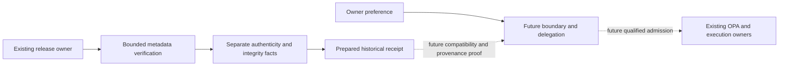

# Trusted Lifecycle foundations (T0–T2)

Status: partial source implementation; all qualification is pending. Baseline
8fa96db378364891e645ed3e22f76218b3412da3 (PR #661).

## Boundaries

The existing release runtime owns discovery, staging and promotion leases,
isolated subprocesses and installed identity. Its checksum status is not
publisher authentication. Policy source sync, lifecycle and OPA remain the
active/known-good/observed authority. System Health's projection reconciliation
and activation fences remain unchanged. No new execution owner is introduced.

The lifecycle registry describes authority metadata, not dispatch. Structured
comparison is intentionally conservative: additions require review, unknown
policy/migration changes remain UX, and root changes require U5 review.
Unchanged metadata is not proof of arbitrary program or Rego equivalence.

The verification primitive uses DSSE v1 PAE and Ed25519 from the existing
cryptography dependency. The caller must provide independently pinned trust
and reliable time; no production keys are provisioned. It binds release,
repository, workflow claim, source commit and fixed digest fields. Signed
workflow claims are not independent build attestations. Full TUF root
rotation, timestamp/snapshot/delegated roles and freeze protection, GitHub
attestation verification and production trust bootstrap are not implemented.
Do not treat the primitive as a qualified production verifier.

No future execution is enabled. T3 requires compatible-policy proof and
current OPA decision; T4 requires release/provenance/migration/checkpoint
qualification; T5 requires explicit feature authority; T6 maps existing domain
registries; T7 adds enterprise profiles with independent approval.

## Qualification handover

Authoring only. No tests, builds, checks, generators, scans, CI remediation or
device execution performed. Before readiness: inspect the exact candidate,
complete missing integration, run focused backend and crypto fixtures, mocked
desktop/mobile accessibility and visual tests, isolated Linux/Termux verification
with synthetic keys, rollback/replay and negative authority tests, then canonical
documentation generation and existing repository gates. Review exact-head CI.
Never provision production keys or activate unattended operation as part of
test qualification.

## Review-only worker integration (source, unqualified)

The existing release check may invoke the existing bounded subprocess with the
fixed operation `verify_trust` if the administrator has explicitly configured
`POCKETLAB_RELEASE_ROOT_SHA256`. It hashes a locally staged candidate and
checks exact discovered tag/commit/artifact/channel. A current release lease
fences transactional receipt and anti-rollback-floor persistence (migration
0058). Repeated identical versions preserve the historical receipt; conflicting
versions and earlier tags fail closed. This is not a downloader or an installer.

### Operator provisioning contract (do not apply to production before qualification)

* Independently authenticate the public root and its SHA-256 through an
  out-of-band trusted channel. Pin the fingerprint in the worker's protected
  local configuration, never in release metadata or the UI.
* The private state directory contains `release-trust/root.json`; candidate
  files are placed in `release-trust/candidate/` with the fixed names listed
  in the adapter. Only a local authorized administrator may populate it.
* A recent independently checked UTC anchor is required in
  `release-trust/clock-anchor.json`: `boot_id` from Linux, `monotonic_ns`
  from the same boot, and UTC RFC3339 `utc`. The anchor expires after ten
  minutes; reboot, unsupported platform, absent or malformed anchor blocks
  verification. This is an operator assertion, not a network time attestation.
* Root replacement after a receipt is recorded is blocked; a reviewed root
  rotation and compromised-key recovery protocol remains future work.
* Do not configure a production pin yet: a configured or durably recorded pin
  deliberately blocks legacy promotion until a trusted promotion contract is
  qualified. Historical unprovisioned installations retain the existing flow.

The candidate producer `scripts/dev/lite/prepare_trusted_release_candidate.py`
writes unsigned capability, policy and migration inventories plus a typed
unsigned metadata document and DSSE PAE bytes from exact clean source and
release assets. It performs no signing or publishing. A separately authorized
release signer must sign those exact bytes and create the DSSE envelope.
Production workflow wiring, independent build attestation verification, complete
provenance chain and platform qualification are **missing**, not certified.
The existing release workflow and three legacy assets have not been modified.

## Deferred qualification tasks

`task lite:lifecycle:backend` and `task lite:lifecycle:ui` are authored only.
Do not use the new API on production until the schema, source-policy reconciliation,
Owner/passkey, UI, resource and regression checks have passed. Full mock
Playwright, accessibility, visual, performance, migration and live qualification
coverage is still required. No checks, tests, builds or generation were run
during source implementation.
