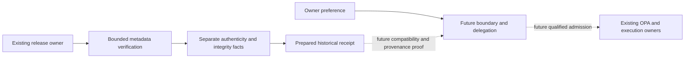

# Trusted Lifecycle foundations (T0–T2)

Status: partial source implementation; all qualification is pending. Baseline
8fa96db378364891e645ed3e22f76218b3412da3 (PR #661).

## Boundaries

The existing release runtime owns discovery, staging and promotion leases,
isolated subprocesses and installed identity. Its checksum status is not
publisher authentication. Policy source sync, lifecycle and OPA remain the
active/known-good/observed authority. System Health's projection reconciliation
and activation fences remain unchanged. No new execution owner is introduced.

The lifecycle registry describes authority metadata, not dispatch. Structured
comparison is intentionally conservative: additions require review, unknown
policy/migration changes remain UX, and root changes require U5 review.
Unchanged metadata is not proof of arbitrary program or Rego equivalence.

The verification primitive uses DSSE v1 PAE and Ed25519 from the existing
cryptography dependency. The caller must provide independently pinned trust
and reliable time; no production keys are provisioned. It binds release,
repository, workflow claim, source commit and fixed digest fields. Signed
workflow claims are not independent build attestations. Full TUF root
rotation, timestamp/snapshot/delegated roles and freeze protection, GitHub
attestation verification and production trust bootstrap are not implemented.
Do not treat the primitive as a qualified production verifier.

No future execution is enabled. T3 requires compatible-policy proof and
current OPA decision; T4 requires release/provenance/migration/checkpoint
qualification; T5 requires explicit feature authority; T6 maps existing domain
registries; T7 adds enterprise profiles with independent approval.

## Qualification handover

Authoring only. No tests, builds, checks, generators, scans, CI remediation or
device execution performed. Before readiness: inspect the exact candidate,
complete missing integration, run focused backend and crypto fixtures, mocked
desktop/mobile accessibility and visual tests, isolated Linux/Termux verification
with synthetic keys, rollback/replay and negative authority tests, then canonical
documentation generation and existing repository gates. Review exact-head CI.
Never provision production keys or activate unattended operation as part of
test qualification.
